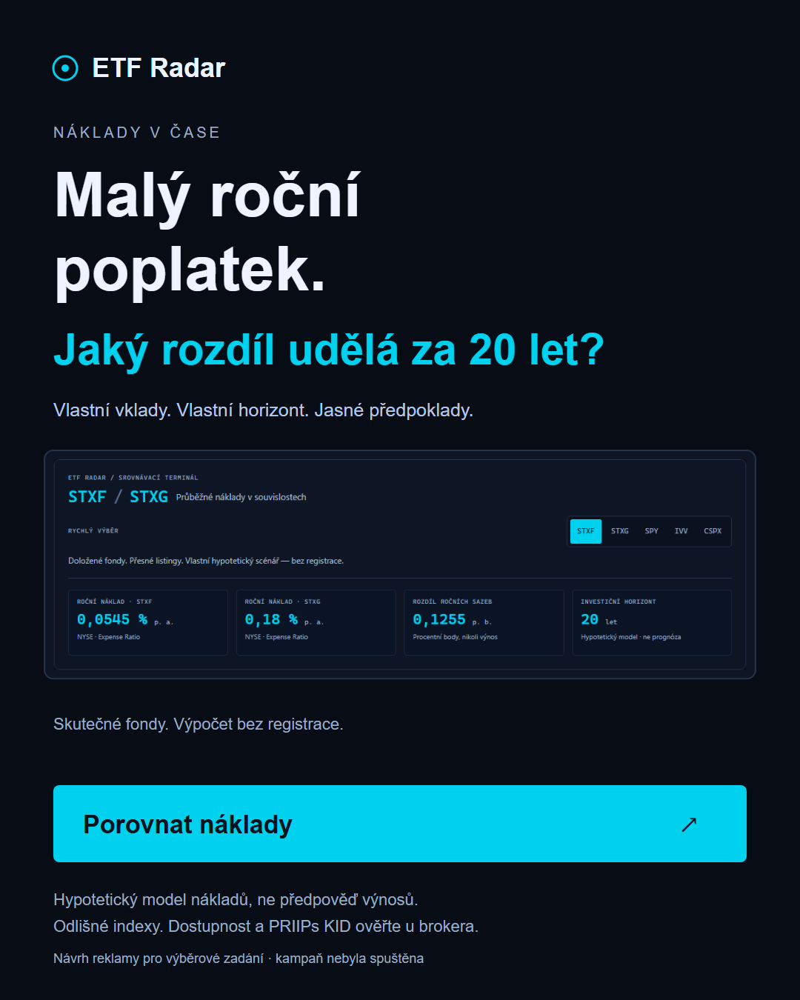
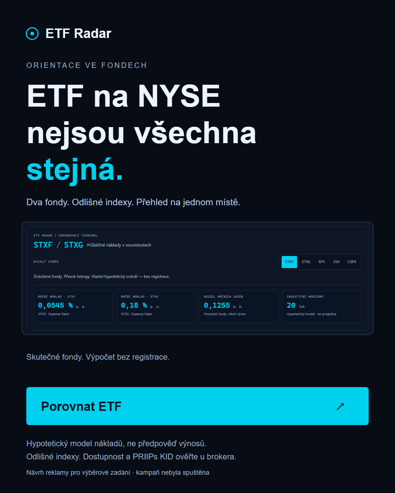

# Dvě české reklamní varianty

Stav: dva hotové reklamní návrhy v PNG a editovatelném SVG, 1080 × 1350 px. Žádná kampaň neběžela a žádný rozpočet nebyl utracen. Landing a ukládání jsou nasazené jako výběrové demo; skutečná kampaň vyžaduje provozní/privacy připravenost.

| Varianta | PNG pro předání | Editovatelný zdroj | Landing |
| --- | --- | --- | --- |
| A — náklady | [ad-a.png](ads/ad-a.png) | [ad-a.svg](ads/ad-a.svg) | [Otevřít A](https://etf-radar-dun.vercel.app/?ad_variant=a&utm_source=meta&utm_medium=paid_social&utm_campaign=costs_v1&utm_content=tool_a) |
| B — orientace | [ad-b.png](ads/ad-b.png) | [ad-b.svg](ads/ad-b.svg) | [Otevřít B](https://etf-radar-dun.vercel.app/?ad_variant=b&utm_source=meta&utm_medium=paid_social&utm_campaign=compare_v1&utm_content=tool_b) |

Obě grafiky obsahují screenshot skutečného srovnání STXF/STXG z lokálního produkčního buildu. Generátor `scripts/generate-ads.mjs` pořídí nový screenshot a exportuje oba formáty (`ADS_ORIGIN` musí ukazovat na běžící aplikaci). Finanční sazby se berou z vykresleného katalogu, ne z ručně zadaných reklamních čísel. Jedná se o verzi katalogu 2026-10-13.1. Viditelné upozornění odděluje model od předpovědi; před reálným použitím sazby znovu ověřit.

## A — Náklady, které se projeví v čase

- **Primary text:** „Roční náklad ETF bývá malé číslo. Jeho modelový dopad za dlouhý horizont už tak malý být nemusí. Porovnejte průběžné náklady dvou fondů na hlavním NYSE, nastavte vlastní vklad a podívejte se na rozdíl. Výpočet bez registrace.“
- **Headline:** „Malý roční poplatek. Jaký rozdíl udělá za 20 let?“
- **Description:** „Vlastní scénář. Ověřené zdroje. Jasné předpoklady.“
- **CTA:** „Porovnat náklady“.
- **Visual:** zobrazení skutečného pracovního nástroje STXF/STXG se sazbami z katalogu a viditelným označením NYSE a upozorněním na odlišné indexy. Žádný předem „vydělaný“ obnos, žebříček vítězů nebo fiktivní performance graf.
- **Audience rationale:** pracovní segment dlouhodobých českých investorů, kteří rozumějí pravidelnému vkladu, ale nepřevádějí malé roční náklady na dlouhý horizont. Jde o hypotézu, ne o výsledek výzkumu.
- **Message match:** `/?ad_variant=a&utm_source=meta&utm_medium=paid_social&utm_campaign=costs_v1&utm_content=tool_a` → přesně tento headline nad skutečným srovnáním; základní výpočet zůstane veřejný.
- **Financial qualifier:** hypotetický model dopadu průběžných nákladů, nikoliv všechny skutečné náklady, forecast nebo garantovaná úspora. Stejný hrubý výnos slouží pouze k izolaci nákladů; nejde o porovnání výkonnosti, stejného očekávaného výnosu nebo rizika ani doporučení. Dostupnost ETF u českého brokera a PRIIPs KID neověřeny. Primární evidence: [NYSE_VERIFICATION](NYSE_VERIFICATION.md), [DATA_SOURCES](DATA_SOURCES.md).

## B — Méně zmatku při srovnávání

- **Primary text:** „STXF a STXG: hlavní NYSE, ale odlišné indexy a strategie. Srovnejte průběžné náklady, nakládání s výnosy a přesný listing. Nejdřív si fondy prohlédněte, až potom řešte kontakt.“
- **Headline:** „ETF na NYSE nejsou všechna stejná.“
- **Description:** „Porovnání fondů a nákladů bez hledání v několika dokumentech.“
- **CTA:** „Porovnat ETF“.
- **Visual:** výřez skutečné srovnávací tabulky / mobilního srovnání. Hlavní výběr STXF/STXG na NYSE, reference SPY/IVV na NYSE Arca a evropský UCITS doplněk CSPX na LSE vizuálně oddělit. Žádný nákupní pokyn.
- **Audience rationale:** investor orientující se v tickerech a rozhodující se, co má před investicí ověřit. Motivace přehlednost, nikoliv výnos; hypotéza pro test.
- **Message match:** `/?ad_variant=b&utm_source=meta&utm_medium=paid_social&utm_campaign=compare_v1&utm_content=tool_b` → stejný headline B a CTA „Porovnat ETF“, stejná funkční workspace a stejný transparentní výpočet.

## Společná nabídka po výsledku

„Jedno číslo není celý příběh. Získejte své ETF srovnání pro 5, 10, 20 a 30 let — včetně rozdílů fondů a checklistu před nákupem.“ CTA „Získat moje srovnání“. Před emailovým polem je skutečný náhled zvoleného scénáře, vypočtený stejným buildReport jako výsledný report.

Report otevřete a stáhnete ihned po zadání emailu. Neposílá se emailem; marketing je volitelný, oddělený a předem nezaškrtnutý. PDF i HTML jsou skutečně vytvořené soubory ke stažení; tisk zůstává vedlejší možnost.

## Měření

Primární business metric: nové unikátní uložené leady / způsobilé měřené landing sessions stejné kohorty. Report use a submit errors jsou guardrails. Reklamní engagement nebo clicks samy nejsou konverzí. A/B ads nejsou automaticky randomizovaný onsite experiment; rozpočty, publika a attribution windows je třeba při vyhodnocení odlišit.

Pracovní rozsah 2–5 % je výhradně hypotéza, nikoliv historická conversion rate. CPL spočítat až ze skutečné útraty a skutečných unikátních leadů. UTM neposílá osobní data, hodnoty jsou allowlisted. Žádné publikování ani placený provoz v tomto milníku.
